# SonoCost — Step-by-Step User Guide

**How to cost any automotive speaker or music system, starting from zero.**

This guide is written for someone who has never done costing before. Follow it top to bottom once (about 20 minutes) and you will be able to produce — and defend — a should-cost for any system the tool supports, from a base 6-speaker setup to a 26-speaker Immersive 4D system with seat actuators. Every number printed in this guide was generated by the tool itself at the settings described, so your screen will match what you read.

> The same guide lives inside the tool: **📘 About → How to Use**. This document adds the screenshots and three worked case studies.

**Contents:** [1. What this tool does](#1-what-this-tool-does-one-paragraph) · [2. Open & sign in](#2-open-the-tool-and-sign-in) · [3. First costing in 8 steps](#3-your-first-costing--8-steps) · [4. The five system tiers](#4-the-five-system-tiers--what-you-are-actually-buying) · [5. Costing a single speaker](#5-costing-a-single-speaker-any-type) · [6. The output tabs](#6-reading-the-output-tabs) · [7–9. Worked examples](#7-worked-example-a--what-should-the-base-audio-cost) · [10. Prove the number](#10-before-you-present-prove-the-number) · [11. Glossary](#11-plain-language-glossary) · [12. Five common mistakes](#12-five-mistakes-every-new-grad-makes-once)

---

## 1. What this tool does (one paragraph)

SonoCost builds cost **bottom-up**, the way a supplier's own cost engineer would: every gram of material (magnet, cone, voice-coil wire…), every minute of factory labour and machine time, then overheads, tooling, freight, duty and margin. You describe the system on the left side of the screen; the tool prices it live on the right — for any of **22 manufacturing countries**, each with its own rate card (labour, electricity, machine rates) carrying a **source, date and confidence badge** — no blanket "country multipliers". Any number can be opened with its **Σ trace** to see the arithmetic behind it. That is the whole idea: *a number you can explain line by line.*

---

## 2. Open the tool and sign in

Open `speaker-cost-engine.html` in any browser, or click the **▶ START SONOCOST** button in [`SONOCOST.md`](SONOCOST.md).

The login page has two tabs. First time: switch to the **Sign Up** tab and create an account — name, any email, and a password of at least 6 characters (it stays in your own browser; still, don't reuse a real password). After that, the **Sign In** tab (email + password) gets you back in.

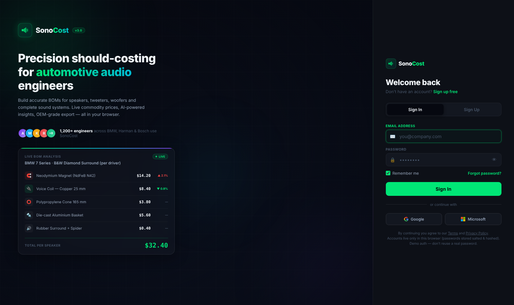

You land on the **System Overview** with a Standard 6-speaker system in China already priced. With nothing touched, the headline tile reads **$42.02**. If you see that number, everything is working.

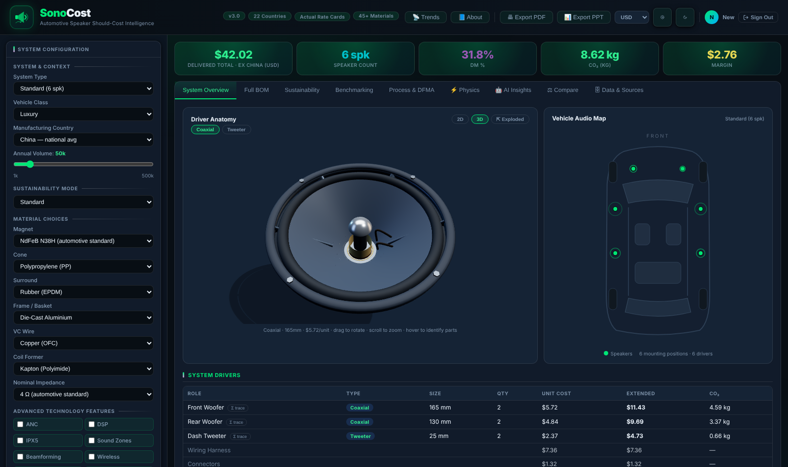

### The screen in 60 seconds

| Area | What it is |
|---|---|
| **Left panel** | Your inputs: system type, country, volume, materials, technology features, freight/duty/margin. Change anything — the whole tool re-prices instantly. |
| **Five big tiles** | Your answer: **Delivered Total** (the headline), speaker count, DM% (material share of cost), CO₂, margin. |
| **Tab bar** | The evidence: System Overview, Full BOM, Sustainability, Benchmarking, Process & DFMA, Physics, AI Insights, Compare, Data & Sources. |
| **Driver Anatomy + Vehicle Audio Map** | What you are pricing: a 2D/3D/exploded view of each speaker type, and an SUV skeleton showing where every speaker sits, with music-wave animation. |
| **Top-right buttons** | 📡 Trends (live commodity prices), 📘 About (guide + technical reference), Export PDF/PPT, currency selector (USD/GBP/EUR/CNY/INR/JPY — display only; the engine computes in USD). |

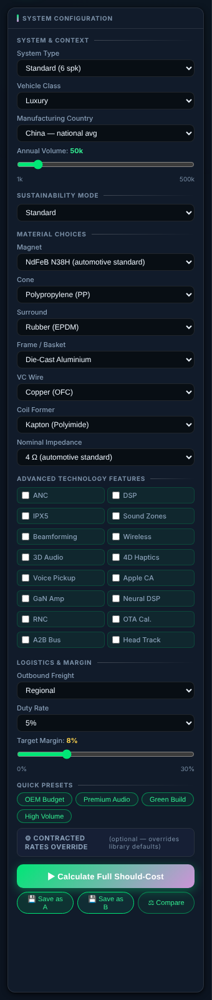

---

## 3. Your first costing — 8 steps

1. **Sign in** (above). You start from a working baseline: Standard, China, 50k vehicles/year.
2. **Pick the System Type** (top of left panel). This is the biggest cost decision — it sets speaker count, amplifier, DSP, A2B bus, and (for 4D) seat actuators. The five tiers are explained in the next section.
3. **Pick the Manufacturing Country.** 22 real choices, each labelled with who actually builds there (*Vietnam (Foster speaker hub)*, *Brazil (Harman/JBL Selenium)*…). Picking a country swaps in that country's actual labour rates, electricity price and machine-hour costs. China comes in three flavours — *national avg* (the default used throughout this guide), *Coastal (Guangdong)* and *Inland* — with slightly different labour rates, so note which one you picked. **Cost the system where it will really be built, not where your office is** — the same Premium system is **$171 built in China and $294 built in Germany**.
4. **Set the Annual Volume** slider (1k–500k vehicles/year). Volume mainly changes how tooling (moulds, dies, fixtures) is spread: one tool set per speaker type, amortised over 4 years. Low volume = each unit carries more tooling. Get the number from the vehicle programme team; 50k is a typical single model, 150–250k a shared platform. Two real-world cautions: (a) many OEM programmes **pay production tooling on a separate tooling PO**, in which case the supplier's piece price contains no tooling — zero it out mentally (or compare against the tool's works cost *minus* the tooling line in the Σ trace) before comparing; (b) the model holds material rates flat with volume, but in reality purchased electronics and magnets carry volume price breaks — treat low-volume material costs as slightly optimistic.
5. **Review the material choices — the defaults are correct.** NdFeB N38H magnet, PP cone, rubber surround, die-cast aluminium frame, OFC copper wire, Kapton former, 4 Ω: that is the automotive mainstream, straight from teardowns. Only change them to model a specific design. Every change re-prices instantly, so the fastest way to learn is to flip one and watch the BOM move.
6. **Tick technology features** only if the spec has them: ANC, DSP, sound zones, 4D haptics, A2B bus, GaN amp, neural DSP, OTA calibration, head tracking… each adds its real component cost. Leave all unticked for a base costing.
7. **Set the commercial lens.** Freight (Domestic/Regional/International), import duty, and target margin decide which question you are answering. The defaults (Regional, 5% duty, 8% margin) answer *"what should we pay a Tier-1, delivered?"* — see §7 for the EXW variant. One convention to know: **the margin slider applies to works cost**. Suppliers usually quote margin as a % of *selling price*, so a supplier's "8% margin on sales" corresponds to about 8.7% on this slider (X% on sales ≈ X⁄(100−X) on cost).
8. **Press ▶ Calculate Full Should-Cost** (the tool also re-prices live). Read the five tiles, then scroll down the Overview: the per-speaker table, the cost build-up from works cost to delivered total, and the system electronics lines (amp, wiring, connectors).

---

## 4. The five system tiers — what you are actually buying

All totals below are the live engine at all-default settings (China, 50k/yr, Luxury class, Regional freight, 5% duty, 8% margin). Your screen will match them.

| Tier | What it physically is | Electronics | Delivered total |
|---|---|---|---|
| **Standard** (6 spk) | 2 front + 2 rear coaxials, 2 dash tweeters — base-car radio sound | Head-unit amplified, **no external amp** | **$42.02** |
| **Enhanced** (8 spk) | Separates up front, centre speaker, 250 mm boot subwoofer | 4-ch Class-D amp + DSP ($39 of the total) | **$118.50** |
| **Premium** (12 spk) | Branded-audio territory (Harman Kardon class): 3-way front stage, centre, sub | 8-ch amp + DSP ($61) | **$171.10** |
| **Immersive 3D** (22 spk) | Adds **height**: A-pillar + roof speakers, headrest tweeters — Atmos-style overhead sound | 14-ch/840W amp + DSP + **A2B digital bus** (saves ~45% cable) | **$269.47** |
| **Immersive 4D** (26 spk) | 3D plus **4 seat actuators** — exciters that shake the seat with the bass. That is the "4th dimension": you *feel* it | 18-ch/1080W amp, DSP, A2B ($115) | **$319.78** |

Where the jumps come from: Standard→Enhanced adds the amplifier and subwoofer. Premium→3D nearly doubles the electronics (14-ch amp + A2B) and adds 10 speakers. 3D→4D adds four $3.04 actuators and four more amp channels (14 → 18).

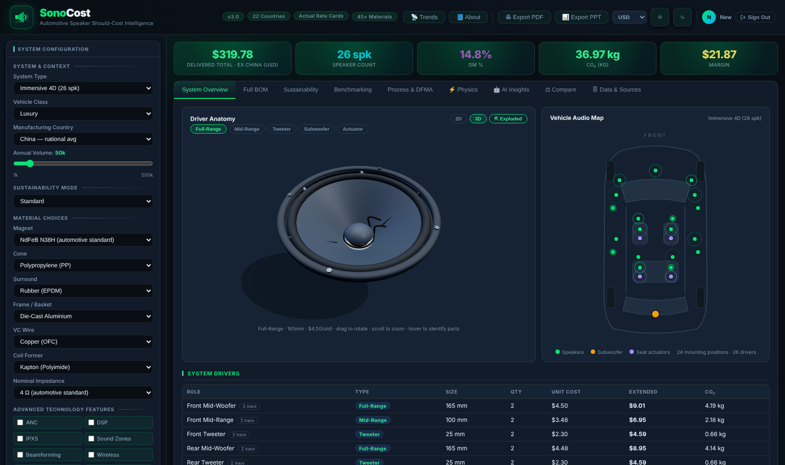

---

## 5. Costing a single speaker (any type)

Every system is built from individual drivers, each priced separately in the **System Drivers** table on the Overview. In the Standard system:

| Driver | Type | Size | Qty | Unit cost (works) |
|---|---|---|---|---|
| Front Woofer | Coaxial | 165 mm | 2 | **$5.72** |
| Rear Woofer | Coaxial | 130 mm | 2 | **$4.84** |
| Dash Tweeter | Tweeter | 25 mm | 2 | **$2.37** |

A subwoofer lives in Enhanced and up ($16.28 at 250 mm, $20.04 at 300 mm); seat actuators ($3.04) only in Immersive 4D. Pick the tier that contains the speaker type you need.

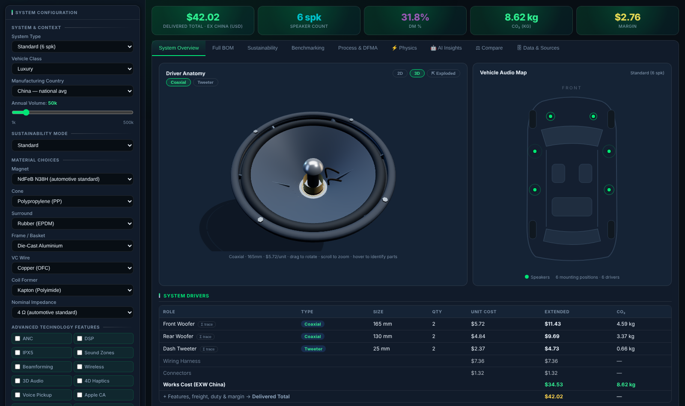

### Open its Σ trace — the whole calculation, live

Click **Σ trace** on any row. You get the complete arithmetic:

- every BOM line as *grams × $/kg × scrap* — the coax magnet reads `28.00g × $38.00/kg × 1.02 scrap = $1.085`
- every process step as *minutes × machine rate + crew × labour rate* — e.g. `VC Winding: 0.96min × ($1.3/hr mach + 0.33×$4.3/hr lab) = $0.045`
- then overheads, tooling amortisation and the roll-up to the unit works cost.

This is the page to screenshot into a supplier negotiation. Press `Esc` to close. The amplifier has its own trace on the electronics line.

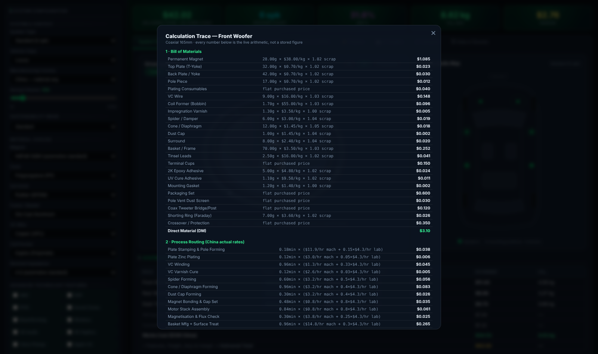

### See what you are pricing

In **Driver Anatomy**, click a speaker-type chip. The chips track the current system — Standard shows only *Coaxial* and *Tweeter*; switch to Immersive 4D to see *Full-Range, Mid-Range, Tweeter, Subwoofer, Actuator*. Then click **3D**, and the **⇱ Exploded** button that appears next to it (Exploded only shows in 3D mode). The exploded view labels every sub-assembly — gasket, surround, cone, basket, spider, voice coil, motor stack — which are exactly the BOM groups you just saw in the Σ trace. New grads: spend five minutes here. The cost model makes sense once you can see the part.

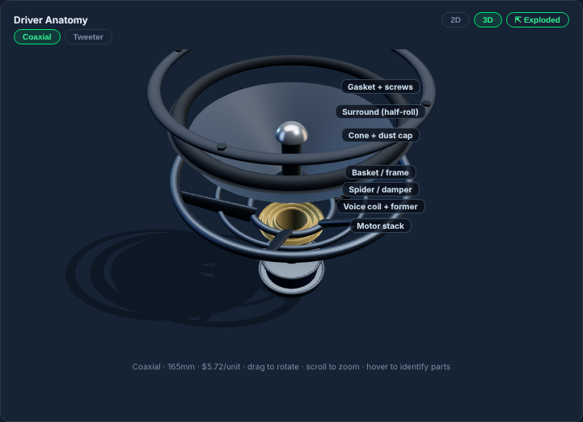

---

## 6. Reading the output tabs

| Tab | The question it answers |
|---|---|
| **System Overview** | What does it cost, and which drivers/electronics make up the total? |
| **Full BOM** | Every material line per driver: grams, $/kg, scrap, cost, CO₂, % of cost. |
| **Process & DFMA** | Every manufacturing step: machine class, minutes, labour, machine $, scrap. |
| **Physics** | Are the material choices acoustically coherent? (Fs, sensitivity, Qts — with warnings.) |
| **Sustainability** | CO₂ per material and system, recycled/bio content, compliance flags. |
| **Benchmarking** | Your cost vs 10 real systems (Bose, Harman Kardon, B&O, Burmester, CN-EV 4D…). |
| **AI Insights** | Rule-based cost position, risks and levers; add a Claude API key for narrative analysis. |
| **Compare** | A vs B delta on the summary lines — system total, direct material, direct labour, overhead (FOH), tooling amortisation, target margin, DM%, CO₂, speaker count — plus a diff of what configuration changed. |
| **Data & Sources** | Every rate the engine is using *right now*, with source, date and confidence badge. |

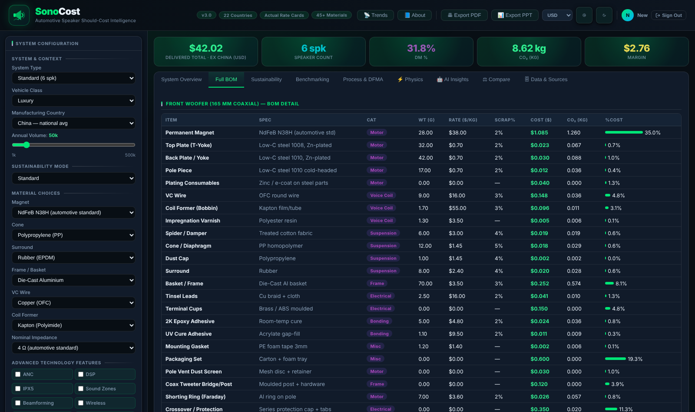

---

## 7. Worked example A — "What should the base audio cost?"

*Goal: should-cost for a Standard 6-speaker system, built in China, 50k/year, delivered.*

1. Leave every default. Read the tiles: **Delivered Total $42.02**, 6 spk, DM 31.8%, CO₂ 8.62 kg, margin $2.76.
2. Scroll the cost build-up: **works cost $34.53** (the factory-gate cost), + freight $2.86 + duty $1.87 + margin $2.76 = $42.02. Note there is **no amplifier line** — Standard is head-unit amplified; wiring ($7.36) and connectors ($1.32) carry the system cost. The waterfall also shows the smaller Tier-1 cost layers — SG&A, ED&D recovery, ICC/payment terms, warranty, inbound logistics, integration parts — all defined in the glossary (§11).
3. Open the Σ trace of the Front Woofer and skim it once — DM $3.10, then process, overheads, tooling.
4. Benchmarking tab: a Standard system beats 10/10 benchmarks — expected, since the benchmarks are branded systems.

**To compare against a supplier's EXW (factory-gate) quote:** set **margin 0%** and **duty 0%**, and read the **works cost**, not the delivered total. Comparing a delivered total to an EXW quote is the most common new-grad mistake.

## 8. Worked example B — "China or Germany?" (Compare tab)

*Goal: quantify the relocation delta for the Premium 12-speaker system.*

1. Set System Type = Premium, country = China. Click **💾 Save as A** (bottom of the left panel).
2. Change country to **Germany**. Total jumps **$171.10 → $293.59** (+72%). The front mid-woofer alone goes $4.50 → $12.13/unit.
3. Click **💾 Save as B**. The Compare tab opens with the delta on the summary lines: direct material barely moves (+$0.75 — commodities are global), while **direct labour (+$40.18) and overhead (+$16.83)** carry the gap. (These are the big movers, not an exhaustive sum — freight, duty and margin also scale into the +$122.49 total.)
4. Export PPT — the deck now contains your A/B case.

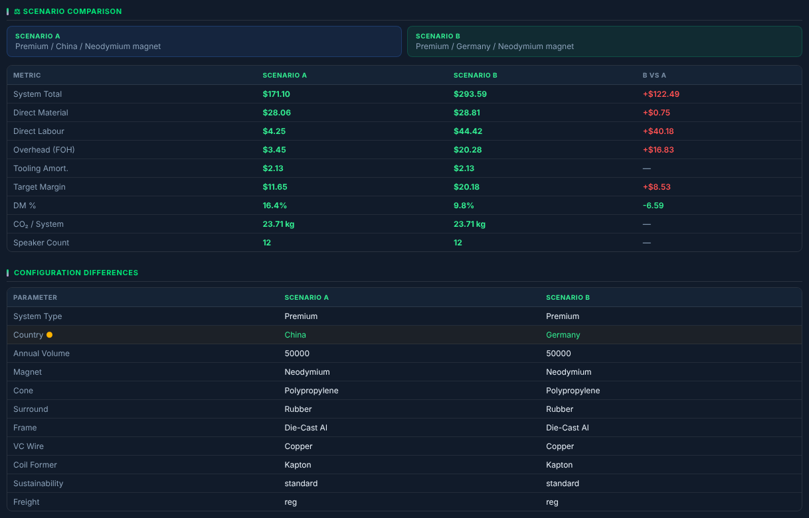

## 9. Worked example C — "Validate a flagship 4D quote"

*Goal: sanity-check a supplier quoting an Immersive 4D system.*

1. System Type = **Immersive 4D**, China, your programme volume. Read: **$319.78 delivered / $273.38 works** — 26 speakers including 4 seat actuators at $3.04 each, and an 18-channel A2B amplifier at $115.45 (open its trace to see amp ICs, DSP, PSU, PCB, housing priced separately).
2. Benchmarking tab: the engine's own 4D works cost sits right beside the **CN-EV 4D benchmark (~$310 est.)** — it beats 4 of 10 benchmarks, which is correct for a flagship (the list includes budget systems; you want to land *inside the corridor* of comparable tiers, not win every row).
3. Sanity rule: a Chinese ODM's customer price **× 0.89** ≈ factory cost (GGEC reports a ~11% gross margin — margin on *price*, so you multiply by (1 − 0.11), not divide by 1.11). A quote far above your should-cost + reasonable margin is your negotiation target.

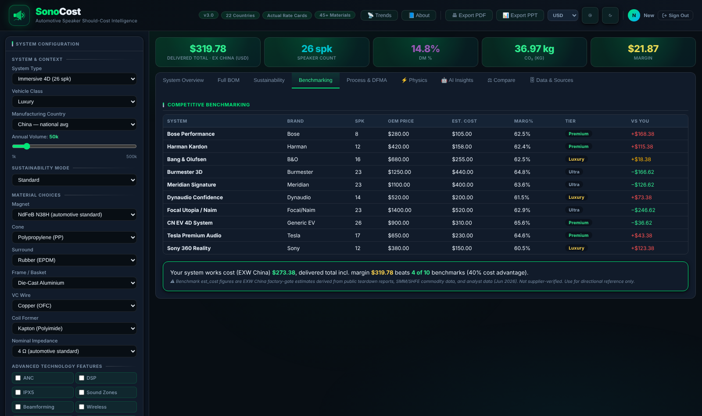

---

## 10. Before you present: prove the number

- **Σ trace** the most expensive driver and the amp. If you can read each line aloud and it makes sense, the number is defendable.
- **Data & Sources tab** — every rate with source, date and a HIGH/MED/LOW confidence badge. Items marked EST are engineering estimates and labelled as such; nothing in the tool pretends to be sourced data unless it is.
- **Benchmarking** — land inside the corridor of comparable systems.
- **Export** — PDF/PPT buttons generate the deck (KPIs, BOM, waterfall, benchmarks). Switch the display currency first if your audience thinks in €, ₹ or ¥.
- **Date-stamp your output.** Commodity and FX inputs move — the footer shows the rate vintage ("rates Oct-2026"), and 📡 Trends shows the live tickers. Note the NdFeB and copper basis on your slide, and rerun the tool shortly before the negotiation rather than reusing last quarter's number.

### Handling a real supplier quote

When a real quote lands on your desk, normalise before comparing — differences are usually in the commercial wrapper, not the parts:

1. **Match the incoterm.** EXW quote → margin 0%, duty 0%, compare to **works cost**. DDP/delivered quote → compare to the delivered total with the right freight mode and duty.
2. **Check who pays tooling.** If tooling is on a separate PO (common), subtract the tooling-amortisation line (visible in the Σ trace) from the tool's figure first.
3. **Match the volume.** Re-run the tool at the quoted volume — a quote at 20k/yr against your 100k model flatters nobody.
4. **Ask what's excluded.** Packaging type, payment terms, warranty terms and ED&D recovery are the classic places a "cheap" quote hides cost — the waterfall lines tell you what to ask about.

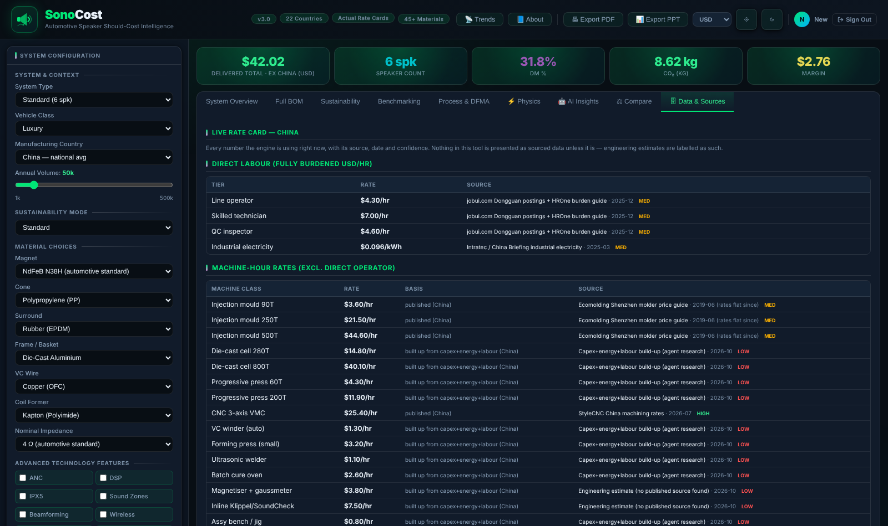

---

## 11. Plain-language glossary

| Term | Meaning |
|---|---|
| **Works cost (EXW)** | Everything it costs to make it and hand it over at the factory gate. No freight, duty or profit. |
| **Delivered total** | Works cost + freight + duty + supplier margin — what the car maker actually pays. |
| **DM / DM%** | Direct material cost / its share of the total. High DM% (Standard ≈ 32%) = materials-driven; low (Premium ≈ 16%) = electronics and conversion dominate. |
| **Conversion** | Direct labour + machine time — the cost of turning materials into product. |
| **FOH / G&A** | Factory overhead (supervision, maintenance, space) and general & administration, loaded as percentages per Tier-1 convention. |
| **Tooling amortisation** | Moulds, dies, fixtures bought up front, spread over 4 years of volume. |
| **Driver** | One speaker unit. A **coaxial** is a woofer with a tweeter mounted in its centre (2-in-1). |
| **Actuator / exciter** | A "speaker" with no cone that shakes the surface it is bolted to — here, the seat (the 4D effect). |
| **DSP** | Digital sound processor — the tuning chip. |
| **A2B** | A 2-wire digital audio bus replacing big analog cable bundles (~45% cable saving). |
| **ANC** | Active noise cancellation. |
| **NdFeB N38H / N52** | Neodymium magnet grades — higher number = stronger = dearer. N38H is the automotive workhorse. Ferrite is the cheap, heavy alternative. |
| **Scrap** | Material lost in production, costed as a small multiplier (×1.02 = 2% loss). |
| **SG&A** | Selling, general & administrative cost — the supplier's commercial overhead layer. |
| **ED&D recovery** | Engineering, Design & Development — the supplier's development effort for your programme, amortised into the piece price. |
| **ICC / payment terms** | Inventory carrying cost — the financing cost of stock and of waiting 60–90 days to get paid. |
| **Warranty accrual** | A small per-unit provision for field failures the supplier must cover. |
| **Inbound logistics** | Freight on the materials coming *into* the factory (outbound freight to the customer is the separate line). |
| **Integration parts** | The per-driver extras that make a speaker fit a car: brackets, pods, grilles, connectors. |
| **Margin (here)** | Applied to **works cost** in this tool. A supplier's "margin on sales" of X% ≈ X⁄(100−X) on this slider. |

## 12. Five mistakes every new grad makes once

1. **Comparing the Delivered Total against an EXW quote.** Different questions — margin 0%, duty 0%, read Works Cost for factory-gate comparisons.
2. **Costing in the wrong country.** The question is where the *supplier's plant* is, not where your office is.
3. **Gold-plating materials "to be safe."** Kevlar cones and N52 magnets belong in flagship systems only; the defaults are what real teardowns show.
4. **Ignoring volume.** At 10k/yr tooling can dominate a driver's cost; at 250k it nearly vanishes. Always confirm the programme volume.
5. **Presenting a number without opening its Σ trace.** The first question will be *"how did you get this?"* — the trace **is** the answer.

---

*All figures in this guide were produced by the tool at the stated settings (engine v3.0, rates Oct-2026). The tool is a directional should-cost model: items marked EST in Data & Sources are engineering estimates, and supplier RFQs always take precedence for formal business cases.*
